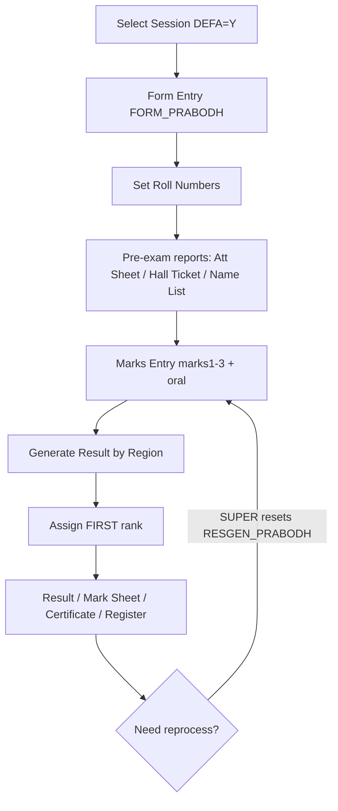

# Business Rules and Workflow Document — Prabodh

Document ID: BRW-PRABODH-001

---

## 1. End-to-end workflow

## 2. Business rules catalogue

| Rule ID | Rule | Confirmed logic | Source |
|---------|------|-----------------|--------|
| RULE-PRB-01 | Active session only | `session where defa='Y'` | Form_Activate |
| RULE-PRB-02 | Mandatory candidate fields | Name, Form Centre, Exam Centre, Gender | check_data |
| RULE-PRB-03 | Centre open | close_flag <> 'Y' | Txt_Form_Centre_Validate |
| RULE-PRB-04 | Region inheritance | centre.district → district.region_no | nested SELECT |
| RULE-PRB-05 | Gender domain | M or F only | Txt_Gender_Change |
| RULE-PRB-06 | SrNo allocation | max(srno)+3 (or Prev_SrNo+1 if Insert-between) | Cmd_save_Click |
| RULE-PRB-07 | Form lock after result | RESGEN_PRABODH='Y' disables CRUD | Form_Activate |
| RULE-PRB-08 | Marks domain | numeric 0–100 or 'A' | AfterColEdit |
| RULE-PRB-09 | Total calculation | tot = Val(m1)+Val(m2)+Val(m3); oral excluded | AfterColEdit |
| RULE-PRB-10 | Oral max | ≤100 | AfterColEdit (2016 change) |
| RULE-PRB-11 | Result eligibility | marks1..3 & oral not null AND result is null AND session & region match | cmd_gen_result |
| RULE-PRB-12 | All absent | m1=m2=m3='A' → Fail / Grade A / tot null | cmd_gen_result |
| RULE-PRB-13 | Partial absent | any 'A' → Fail / X | cmd_gen_result |
| RULE-PRB-14 | Min aggregate | tot &lt; min_total_khand1 (105) → Fail / X | EXAM + code |
| RULE-PRB-15 | Incomplete marks | blank → Result/Grade '-' | cmd_gen_result |
| RULE-PRB-16 | Subject minima | Val(m)&lt;min_marks OR oral&lt;35 → Fail / X | PAPER + hardcoded 35 |
| RULE-PRB-17 | Pass grades | ≥225 Vi.Yo.; ≥180 →1; ≥150 →2; else 3 | EXAM thresholds |
| RULE-PRB-18 | Pass result text | "Pass" | cmd_gen_result |
| RULE-PRB-19 | Rank FIRST | clear special_rank; all PASS with max tot_marks → FIRST | rank loop |
| RULE-PRB-20 | Paper minima source | PAPER where exam_no=5: min_marks currently 25 each | DB |

### Current master thresholds (DB snapshot)

| Parameter | Value |
|-----------|-------|
| Papers | 3 |
| Fees | 18 |
| Min total | 105 |
| Class 1 / 2 / 3 | 180 / 150 / 105 |
| Distinction (Vi. Yo.) | 225 |
| Paper min_marks | 25 |
| Paper passing_marks | 35 |
| Oral pass minimum | **35 (hardcoded)** |

## 3. State transitions (candidate)

| State | Indicators | Allowed |
|-------|------------|---------|
| Form only | marks null | Edit form; set roll |
| Marks partial | some marks null | Continue marks |
| Marks complete | all marks non-null, result null | Eligible for generate |
| Resulted | result/grade set | Reports; form locked if RESGEN=Y |
| Reopened | SUPER clears flag / result nulling | Re-entry |

## 4. Assumptions

- ASSUM-PRB-01: `passing_marks` in PAPER is informational for Prabodh; generate uses `min_marks` + oral 35.
- ASSUM-PRB-02: REG_LANG column exists on table but is not used on Prabodh form UI (column present in schema).

## 5. Ambiguities

1. When is `SESSION.RESGEN_PRABODH` set to Y? Not in reviewed generate click handler.
2. SECOND rank and region-wise “FIRST IN …” are commented — confirm current business need.
3. `DummyCentreCode` usage not evidenced on form — confirm.
4. Oral included in pass rule but not in tot/grade thresholds — confirm intentional.
