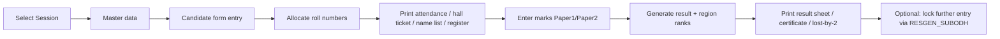

# Business Requirements Document (BRD) — Subodh Exam Modernization

| Field | Value |
|-------|-------|
| Document ID | SUB-BRD-001 |
| Version | 0.1 (Draft for review) |
| Exam scope | **Subodh only** (legacy EXAM_NO = 4) |
| Source system | MrsExam VB6 + Access MDB |
| Target | React + TypeScript + MUI / ASP.NET Core / SQL Server |
| Related | `00-Source-Inventory-and-Application-Overview.md` |

---

## 1. Executive summary

Modernize the **Subodh** exam lifecycle of the legacy MrsExam desktop application into a web architecture while **preserving existing business functionality**. Subodh covers candidate registration, roll-number allocation, two-paper marks entry, automated result/grade/rank computation, and a set of pre-/post-exam printed outputs.

This BRD documents **confirmed** behaviour from VB6 source and Access schema. Items requiring business confirmation are listed in Section 9.

---

## 2. Business goals

| ID | Goal |
|----|------|
| BG-001 | Preserve Subodh operational parity with legacy MrsExam for the current session workflow |
| BG-002 | Replace Access with SQL Server; replace VB6 UI with React; expose business logic via ASP.NET Core APIs |
| BG-003 | Improve maintainability, concurrency, Unicode Hindi support, and auditability without changing exam rules unless approved |
| BG-004 | Support the same printed artefacts (attendance, hall ticket, name list, register, result sheet, certificate, lost-by-2-marks) |

**Non-goals (Phase 1):** generating the full application code; modernizing other exams; inventing new business rules.

---

## 3. Stakeholders & users

| Role | Legacy evidence | Notes |
|------|-----------------|-------|
| Data entry operator | `USERS` + `FORM_SUBODH.userid` stamped on save | Enters candidates / marks |
| Exam administrator | Session selection, result generation, roll set, reports | **Assumption:** same login pool |
| System operator | Backup / export menus | Ops tasks |

**Ambiguity OQ-001:** No fine-grained role/permission matrix found beyond userid/password/`KEY` in `USERS`. Confirm roles for the web system.

---

## 4. Current-state business context

### 4.1 What Subodh is

Subodh is exam **#4** in the `EXAM` master: **2 papers**, fee **15**. Candidate transactional data lives exclusively in **`FORM_SUBODH`**. Geography is Region → District → Centre. Work is always scoped to the **default session** (`SESSION.DEFA = 'Y'`).

### 4.2 End-to-end business process (Subodh)

### 4.3 Key business objects

| Object | Legacy store | Business meaning |
|--------|--------------|------------------|
| Session | `SESSION` | Exam sitting; default flag; Subodh result-gen lock |
| Region / District / Centre | `REGION`, `DISTRICT`, `CENTRE` | Geography & exam centres |
| Candidate application | `FORM_SUBODH` | Person, centres, marks, result |
| Exam rules | `EXAM` (row 4), `PAPER` (exam 4) | Pass thresholds, grades |
| User | `USERS` | Login identity stamped on forms |

---

## 5. Business requirements (by module)

### Module M1 — Authentication & Session

| ID | Requirement | Priority | Source | Status |
|----|-------------|----------|--------|--------|
| BR-001 | Users must authenticate before using Subodh functions | Must | `frmLogin.frm`, `USERS` | Confirmed |
| BR-002 | System must operate against a selectable **default session**; Subodh entry uses `session where defa='Y'` | Must | `Frm_FormSubodh.Form_Activate`, `Frm_SelectSession` | Confirmed |
| BR-003 | When no default session exists, Subodh form entry must not proceed | Must | MsgBox “Session not selected” / unload | Confirmed |

### Module M2 — Master Data (Subodh dependencies)

| ID | Requirement | Priority | Source | Status |
|----|-------------|----------|--------|--------|
| BR-010 | Maintain Region, District, Centre masters used by Subodh forms and reports | Must | MDI Masters menu; joins in forms | Confirmed |
| BR-011 | Closed centres (`CENTRE.CLOSE_FLAG='Y'`) must not be accepted as Form Centre | Must | `Frm_FormSubodh.Txt_Form_Centre_Validate` | Confirmed |
| BR-012 | Maintain Exam #4 and Paper 1/2 rules (min/passing/exemption marks; class/distinction totals) | Must | `Frm_Exam`, `Frm_Paper`; used by result gen | Confirmed |
| BR-013 | Maintain Institution name/address for report headers | Should | `INSTITUTION` via `Module1.Db_Conn` | Confirmed |

### Module M3 — Candidate Form Entry

| ID | Requirement | Priority | Source | Status |
|----|-------------|----------|--------|--------|
| BR-020 | Capture Subodh candidates for default session with: Name, Gender (M/F), Form Centre, Exam Centre, Region (auto from form centre’s district), optional Roll No, Session (read-only) | Must | `Frm_FormSubodh` | Confirmed |
| BR-021 | Support New, Save, Update, Delete, Undo, First/Prev/Next/Last, Search, Insert-between, Exit | Must | Form buttons + `ClassMaster` | Confirmed |
| BR-022 | Validate Name, Form Centre, Exam Centre, Gender as mandatory before save | Must | `check_data` | Confirmed |
| BR-023 | Validate Form/Exam Centre exist in Centre master; resolve centre name/city display | Must | Validate handlers | Confirmed |
| BR-024 | Auto-derive Region from Form Centre → District → Region | Must | `Txt_Form_Centre_Validate` | Confirmed |
| BR-025 | On New, default Exam Centre = Form Centre | Must | `Txt_Form_Centre_Change` | Confirmed |
| BR-026 | Stamp `userid` with logged-in user on new save | Must | `Cmd_save_Click` | Confirmed |
| BR-027 | Allocate internal `SRNO` as `max(srno)+3` for normal new records; or `Prev_SrNo+1` when inserting between | Must | `Cmd_save_Click`, Insert flow | Confirmed (reason for +3: **OQ-002**) |
| BR-028 | Show count of forms for current Form Centre + session | Should | `ClassMaster.CountFormsForCentre` | Confirmed |
| BR-029 | When `SESSION.RESGEN_SUBODH='Y'`, disable New/Insert/Save/Undo/Update/Delete | Must | `Form_Activate`, `Proc_CheckResultGen` | Confirmed |
| BR-030 | Search candidates by name (and related search UI) within default session | Must | `Frm_Search` case `Frm_FormSubodh` | Confirmed |

### Module M4 — Roll Number Allocation

| ID | Requirement | Priority | Source | Status |
|----|-------------|----------|--------|--------|
| BR-040 | Allocate sequential roll numbers to Subodh candidates by seat-region / centre order for a session | Must | `Frm_SetRollNo1` with `LblExam=Subodh` | Confirmed |
| BR-041 | Process centres that have forms; skip centres with zero forms; continue from max existing roll in region | Must | SetRollNo centre walk logic | Confirmed |
| BR-042 | Support Aurangabad-specific roll numbering path for Subodh | Should | MDI `Sub_AurRollNoSubodh` → `ProcAurSetRollno("Subodh")` | Confirmed existence; detail in FRS |
| BR-043 | Support blank / from-to centre roll utilities for Subodh where menu enables them | Should | Related roll forms | Confirmed menu; full rules **partially analysed** |

### Module M5 — Marks Entry

| ID | Requirement | Priority | Source | Status |
|----|-------------|----------|--------|--------|
| BR-050 | Enter/update `MARKS1` and `MARKS2` for Subodh candidates filtered by session, region, and roll ≥ selected roll | Must | `Frm_SubodhMarks` | Confirmed |
| BR-051 | Accept numeric marks 0–100 or absent code `A` | Must | `DataGrid1_AfterColEdit` | Confirmed |
| BR-052 | Reject non-numeric (except A), negatives, and values > 100 | Must | Same | Confirmed |
| BR-053 | Auto-calculate `TOT_MARKS = Val(marks1)+Val(marks2)` after edit | Must | Same | Confirmed (`A` contributes 0 via `Val`) |
| BR-054 | Disable marks grid editing when `RESGEN_SUBODH='Y'` | Must | `Form_Load` | Confirmed |

### Module M6 — Result Generation & Ranking

| ID | Requirement | Priority | Source | Status |
|----|-------------|----------|--------|--------|
| BR-060 | Generate results region-wise for default session for candidates with both marks present and `RESULT` null | Must | `Frm_GenResultSubodh.cmd_gen_result_Click` | Confirmed |
| BR-061 | Use Paper min marks (exam 4 papers 1 & 2) and Exam grade thresholds (exam 4) | Must | Queries `paper`/`exam` exam_no=4 | Confirmed |
| BR-062 | Apply Fail/Pass/grade rules exactly as legacy (see BR document §6 / Rules doc) | Must | Same procedure | Confirmed |
| BR-063 | Assign region first rank text `FIRST IN {REGION_NAME_ENG}` to all tied top Pass totals | Must | After loop | Confirmed |
| BR-064 | Support special Maharashtra FIRST/SECOND rank assignment for Pass candidates ordered by tot_marks | Should | `Cmd_ranks_Click` | Confirmed; print **commented** (**OQ-003**) |
| BR-065 | Increment `Resgen_run` per generation for session+region | Must | Result gen | Confirmed |
| BR-066 | After generation, show filtered result grid for session+region | Should | Adodc filter | Confirmed |

### Module M7 — Pre-exam outputs

| ID | Requirement | Priority | Source | Status |
|----|-------------|----------|--------|--------|
| BR-070 | Print Subodh attendance sheets by centre/district for default session | Must | `Frm_AttSheet` + `Rpt_AttSheetPraveshika_Subodh` | Confirmed |
| BR-071 | Print Subodh hall tickets filtered by region and optional roll range | Must | `Frm_PrintHallTicket` + `Rpt_HallTicket_Subodh` | Confirmed |
| BR-072 | Print Subodh name list | Must | MDI → NameList + `Rpt_NameListSubodh` | Confirmed |
| BR-073 | Print Subodh register (region/centre grouping) | Must | `Frm_RGOtherThanPandit` / regionwise + `Rpt_RGSubodh` | Confirmed |

### Module M8 — Post-exam outputs

| ID | Requirement | Priority | Source | Status |
|----|-------------|----------|--------|--------|
| BR-080 | Print Subodh result sheet (with name) by session/region/centre | Must | `Frm_ResultSheet` + `Rpt_ResultSheetSubodh` | Confirmed |
| BR-081 | Print Subodh result sheet without candidate name | Must | Menu “For Subodh(no name)” + `Rpt_ResultSheetSubodhnoname` | Confirmed |
| BR-082 | Print Subodh certificates for Pass candidates by session/region/optional roll range | Must | `Frm_Certificate_Printing.CmdSubodh` + `Rpt_Certificate_Subodh` | Confirmed |
| BR-083 | Print “lost by two marks” report for Subodh (exam param 4) | Should | MDI `Sub_LostTwoMarksSubodh` | Confirmed |

### Module M9 — Utilities & operations

| ID | Requirement | Priority | Source | Status |
|----|-------------|----------|--------|--------|
| BR-090 | Support result regeneration UI for Subodh | Should | MDI Regen menu → `Frm_regen_res` | Confirmed menu path |
| BR-091 | Support centre-wise student count reporting including Subodh | Should | `Frm_CentreWiseNoOfStudent` | Confirmed form exists |
| BR-092 | Support export / backup operations that include `form_subodh` | Should | `Frm_ExportData`, `FrmBackup` | Confirmed Subodh branches |
| BR-093 | Track user-wise total forms for exam key `SUBODH` | Could | `TOT_FORMS` | Confirmed table usage pattern |

---

## 6. Summary of Subodh result business rules (normative)

Rules applied in `Frm_GenResultSubodh.cmd_gen_result_Click` using `EXAM`/`PAPER` for exam 4. Current DB values:

| Rule parameter | DB value (exam 4) |
|----------------|-------------------|
| Paper 1 & 2 `MIN_MARKS` | 25 each |
| Paper `PASSING_MARKS` | 35 (loaded but **not used** in the Subodh gen loop — **OQ-004**) |
| `MIN_TOTAL_KHAND1` | 70 |
| `CLASS1_MARKS` | 120 |
| `CLASS2_MARKS` | 100 |
| `DIST_MARKS` | 150 |
| `CLASS3_MARKS` | 70 (present on EXAM; grade “3” is Case Else after class2 — **Confirmed**) |

| Condition | RESULT | GRADE |
|-----------|--------|-------|
| marks1=`A` AND marks2=`A` | Fail | A (tot_marks cleared) |
| Exactly one of marks1/marks2 is `A` | Fail | X |
| tot_marks &lt; min_total_khand1 | Fail | X |
| Either paper empty string | `-` | `-` |
| Either paper &lt; paper min_marks | Fail | X |
| Else Pass; tot ≥ dist | Pass | Vi. Yo. |
| Else Pass; tot ≥ class1 | Pass | 1 |
| Else Pass; tot ≥ class2 | Pass | 2 |
| Else Pass | Pass | 3 |

---

## 7. Non-functional business requirements

| ID | Requirement | Notes |
|----|-------------|-------|
| BR-N01 | Preserve Hindi/English bilingual presentation of names and labels | Legacy uses font encoding → target must use Unicode (**OQ-005**) |
| BR-N02 | Preserve printable layouts equivalent to legacy Data Reports | Pixel-perfect match may be waived with approval |
| BR-N03 | Do not change pass/fail/grade thresholds without written approval | |
| BR-N04 | Support concurrent multi-user entry better than single Access file | Target architecture concern |
| BR-N05 | Secure credentials (replace plaintext Access passwords) | Modernization improvement; confirm policy |

---

## 8. Constraints & assumptions

### Constraints
- Scope locked to **Subodh** exam only.
- Existing business functionality must be preserved unless explicitly approved.
- No invention of missing rules; document as open questions.
- Do not generate complete application in this phase.

### Assumptions (require confirmation)
| ID | Assumption |
|----|------------|
| AS-001 | Web users will mirror current operator/admin split with improved roles |
| AS-002 | Default-session model remains the primary working mode |
| AS-003 | Reports will be regenerated (PDF) rather than hosting VB Data Reports |
| AS-004 | Historical `FORM_SUBODH` rows (~400k) must be migrated |

---

## 9. Open questions for business confirmation

| ID | Question | Impact |
|----|----------|--------|
| OQ-001 | What user roles/permissions are required in the new system? | AuthZ design |
| OQ-002 | Why is new `SRNO` allocated as max+3? Must this be preserved? | Candidate identity |
| OQ-003 | Is Maharashtra FIRST/SECOND special rank still required? Print is disabled in legacy | Ranking/reports |
| OQ-004 | `PASSING_MARKS` (35) is unused in Subodh gen — intentional? | Rules accuracy |
| OQ-005 | Source encoding for Hindi names/fonts — how to migrate to Unicode? | Data migration |
| OQ-006 | Should `RESGEN_SUBODH='Y'` remain a hard lock, or soft with override? | Ops workflow |
| OQ-007 | Are UND_FLAG / UND_CLASS used for Subodh in practice? (fields exist; little UI use found) | Schema/UI |
| OQ-008 | Confirm fee (15) is informational only or used in billing elsewhere | Scope |
| OQ-009 | Must blank-name / placeholder rows (`name='-'`) behaviour be retained? | Data quality |
| OQ-010 | Confirm whether other exams remain permanently out of scope for this product line | Product roadmap |

---

## 10. Success criteria

1. All Must BR-* requirements traced to FRS, UI, API, and tests.
2. Result engine reproduces legacy Pass/Fail/Grade for a representative Subodh sample set.
3. Operators can complete a full session cycle: entry → rolls → prints → marks → result → certificates.
4. Open questions resolved or explicitly deferred with owner.

---

## 11. Approval

| Role | Name | Date | Sign-off |
|------|------|------|----------|
| Business Owner | | | ☐ |
| BA | | | ☐ |
| Technical Lead | | | ☐ |

**Review focus for this draft:** Modules M3–M6 (entry, rolls, marks, result) and Open Questions OQ-001–OQ-006.
