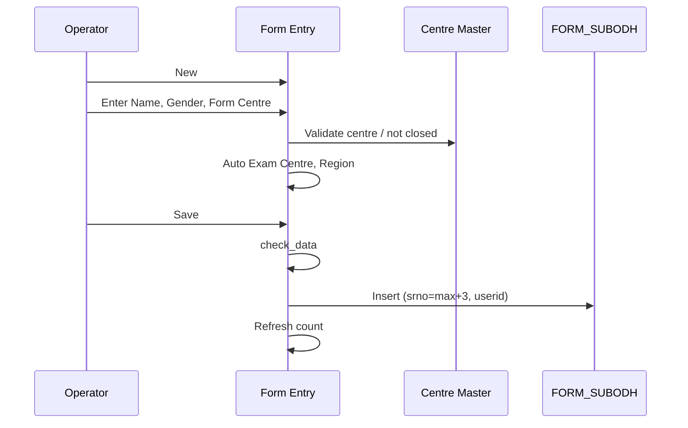

# Business Rules and Workflow Document — Subodh Exam

| Field | Value |
|-------|-------|
| Document ID | SUB-RULE-001 |
| Scope | Subodh only |
| Rule IDs | RULE-xxx |

---

## 1. Workflows

### WF-01 Candidate registration (default session)

**Lock gate:** If `RESGEN_SUBODH='Y'` → mutate buttons disabled (RULE-LOCK-01).

### WF-02 Roll number allocation

1. Select Subodh set-roll menu → session + seat region.
2. System finds centres with forms for that region/session.
3. Assign consecutive rolls from First..Last to candidates ordered by `srno` for current form centre.
4. Advance to next centre with forms; First becomes max(roll)+1.

### WF-03 Marks entry

1. Open Subodh Marks; load default session.
2. Select region + starting roll → Show.
3. Edit Paper1/Paper2; system validates and totals.
4. If result already generated → grid disabled.

### WF-04 Result generation

1. Select region.
2. Load candidates with both marks set and result null.
3. Apply RULE-RES-* per candidate; update run number.
4. Assign region first rank among Pass.
5. Display grid.

### WF-05 Certificate print

1. Certificate menu For Subodh → session + region.
2. Optional roll range.
3. Run `Cmd_Certificate_Subodh` → print report.

---

## 2. Business rules catalogue

### Session & locking

| ID | Rule | Source | Status |
|----|------|--------|--------|
| RULE-SES-01 | Active working session is the row with `DEFA='Y'` | Multiple forms | Confirmed |
| RULE-LOCK-01 | If `RESGEN_SUBODH='Y'`, candidate mutate ops disabled | `Frm_FormSubodh` | Confirmed |
| RULE-LOCK-02 | If `RESGEN_SUBODH='Y'`, marks grid disabled | `Frm_SubodhMarks` | Confirmed |

### Candidate validation

| ID | Rule | Source | Status |
|----|------|--------|--------|
| RULE-CAN-01 | Name mandatory | `check_data` | Confirmed |
| RULE-CAN-02 | Form Centre mandatory & must exist | validate + check_data | Confirmed |
| RULE-CAN-03 | Closed centre (`CLOSE_FLAG='Y'`) rejected for Form Centre | validate | Confirmed |
| RULE-CAN-04 | Exam Centre mandatory & must exist | validate + check_data | Confirmed |
| RULE-CAN-05 | Gender must be M or F | Gender change / check_data | Confirmed |
| RULE-CAN-06 | Region derived from Form Centre → District → Region | validate | Confirmed |
| RULE-CAN-07 | On New, Exam Centre defaults to Form Centre | Change handler | Confirmed |
| RULE-CAN-08 | New SRNO = max(SRNO)+3 (normal) | Save | Confirmed; OQ-002 |
| RULE-CAN-09 | Insert-between SRNO = Prev_SrNo+1 | Save + Insert | Confirmed |
| RULE-CAN-10 | New records stamp userid = logged-in user | Save | Confirmed |

### Marks

| ID | Rule | Source | Status |
|----|------|--------|--------|
| RULE-MRK-01 | Marks value is number 0–100 or `A` | AfterColEdit | Confirmed |
| RULE-MRK-02 | Reject negative / >100 / other non-numeric | AfterColEdit | Confirmed |
| RULE-MRK-03 | TOT_MARKS = Val(marks1)+Val(marks2) | AfterColEdit | Confirmed |
| RULE-MRK-04 | Starting roll must exist for session+region | Roll validate | Confirmed |

### Result / grade (exam_no=4)

| ID | Rule | Source | Status |
|----|------|--------|--------|
| RULE-RES-01 | Only process rows with marks1 & marks2 not null and result null for session+region | GenResult | Confirmed |
| RULE-RES-02 | Both absent (`A`,`A`) → Fail, grade A, tot_marks null | GenResult | Confirmed |
| RULE-RES-03 | One absent → Fail, grade X | GenResult | Confirmed |
| RULE-RES-04 | tot_marks &lt; EXAM.MIN_TOTAL_KHAND1 → Fail, X | GenResult | Confirmed |
| RULE-RES-05 | Empty marks string → result/grade `-` | GenResult | Confirmed |
| RULE-RES-06 | Any paper &lt; PAPER.MIN_MARKS → Fail, X | GenResult | Confirmed |
| RULE-RES-07 | Else Pass; grade by DIST / CLASS1 / CLASS2 / else 3 | GenResult | Confirmed |
| RULE-RES-08 | Grade distinction label = `Vi. Yo.` | GenResult | Confirmed |
| RULE-RES-09 | Region first: all tied top Pass get `FIRST IN {REGION_NAME_ENG}` | GenResult | Confirmed |
| RULE-RES-10 | Special FIRST/SECOND statewide on Cmd_ranks | Cmd_ranks | Confirmed |
| RULE-RES-11 | Increment Resgen_run for session+region | GenResult | Confirmed |
| RULE-RES-12 | Require EXAM and PAPER rows for exam 4 else abort | GenResult | Confirmed |

**Current numeric thresholds (DB snapshot):** min total 70; class1 120; class2 100; dist 150; paper min 25; paper passing 35 (unused in loop — OQ-004).

### Roll allocation

| ID | Rule | Source | Status |
|----|------|--------|--------|
| RULE-ROL-01 | Roll assignment table = `form_` + exam caption (`form_Subodh`) | SetRollNo1 | Confirmed |
| RULE-ROL-02 | Centres ordered by seat_district_no, centre_no | SetRollNo1 | Confirmed |
| RULE-ROL-03 | Skip centres with zero forms | SetRollNo1 | Confirmed |
| RULE-ROL-04 | Continue numbering from max roll in region+session | SetRollNo1 | Confirmed |

### Printing filters

| ID | Rule | Source | Status |
|----|------|--------|--------|
| RULE-PRT-01 | Hall tickets filter by region and optional roll range | PrintHallTicket | Confirmed |
| RULE-PRT-02 | Certificates filter by session, region, optional rolls | Certificate | Confirmed |
| RULE-PRT-03 | Attendance built into AttSheet temp rows (2 columns of rolls) | AttSheet | Confirmed |

---

## 3. Ambiguous / unconfirmed rules

| ID | Topic | Notes |
|----|-------|-------|
| RULE-AMB-01 | SRNO gap of 3 | Confirmed behaviour; business intent unknown |
| RULE-AMB-02 | PASSING_MARKS unused | Loaded, not applied in Subodh gen |
| RULE-AMB-03 | UND_FLAG / UND_CLASS | Columns exist; no Subodh UI usage found |
| RULE-AMB-04 | When RESGEN_SUBODH is set to Y | Not clearly set inside GenResult snippet reviewed — may be manual/session form (**OQ-006**) |
| RULE-AMB-05 | DummyCentreCode maintenance | Used in register prep (`ProcSetDummyCenterCode`) — preserve |

---

## 4. Confirmed vs assumption legend

- **Confirmed:** Observed in Subodh-specific or Subodh-parameterised source/DB.
- **Assumption:** Reasonable modernization inference; needs sign-off.
- **Ambiguous:** Conflicting or incomplete evidence.
