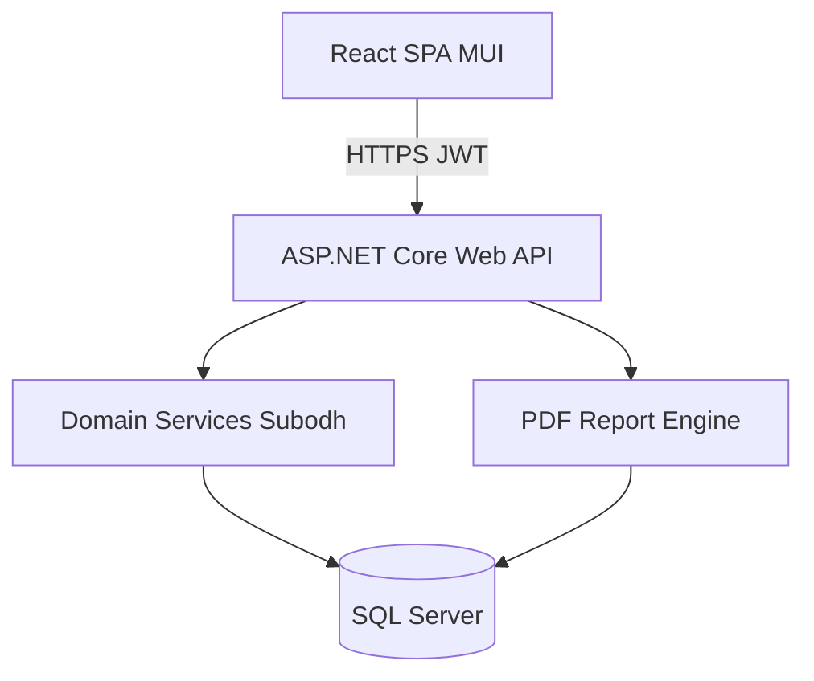

# Target Architecture and Technical Design — Subodh

| Field | Value |
|-------|-------|
| Document ID | SUB-ARCH-001 |
| Frontend | React + TypeScript + MUI |
| Backend | ASP.NET Core Web API (C#) |
| Database | Microsoft SQL Server |

---

## 1. Goals

- Preserve Subodh business parity (BR/FR).
- Replace Access single-file concurrency limits.
- Unicode-first Hindi/English data.
- Clear module boundaries for phased delivery.

---

## 2. Logical architecture



**Layers:** Presentation (React) → API Controllers → Application/Domain Services → EF Core / Dapper → SQL Server.

---

## 3. Solution structure (proposed)

```
src/
  Subodh.Web/                 # React app
  Subodh.Api/                 # ASP.NET Core host
  Subodh.Application/         # Use cases / DTOs / validators
  Subodh.Domain/              # Entities, result rules
  Subodh.Infrastructure/      # EF Core, reports, auth
tests/
  Subodh.Domain.Tests/        # Result engine parity tests
  Subodh.Api.Tests/
```

---

## 4. Key design decisions

| Decision | Choice | Rationale |
|----------|--------|-----------|
| Exam isolation | Dedicated `FormSubodh` table (parity) | Matches legacy; avoids premature unification |
| Result engine | C# domain service (+ optional SP) | Testable RULE-RES parity |
| Marks storage | String allowing `A` | Preserve absent semantics |
| Reports | Server-side PDF (QuestPDF/Stimulsoft/etc.) | Replace VB Data Reports |
| Auth | ASP.NET Identity / JWT over AppUser | Replace plaintext Access passwords |
| SrNo | Configurable allocator (max+3 default) | Honour RULE-CAN-08 until OQ-002 resolved |
| Encoding | NVARCHAR + migration converter | Fix font encoding |

---

## 5. Cross-cutting concerns

- **Validation:** FluentValidation mirroring RULE-CAN/MRK.
- **Transactions:** Result generation and roll assignment must be atomic per region/centre batch.
- **Concurrency:** Optimistic concurrency token on FormSubodh (new) — **modernization** (approve).
- **Audit:** Retain userid; optionally add Created/Updated timestamps — **modernization**.
- **Logging:** Structured logs for generate-result runs (replace MsgBox counts).
- **Security:** Parameterized SQL; no Access password in config; secrets in vault.

---

## 6. Data architecture

See `05-Access-to-SQLServer-Data-Mapping.md`.

Minimal Subodh ER:

```
ExamSession ——< FormSubodh >—— Region
Centre ——< FormSubodh (FormCentre / ExamCentre)
Exam(4) ——< Paper
AppUser ——< FormSubodh
```

---

## 7. Integration & files

Legacy file ops: Access backup/export to folders. Target:

- Admin-triggered SQL backup / BACPAC / export CSV/Excel for Subodh extracts.
- No direct MDB dependency in production.

External deps to retire: MSADODC, Data Environment, Data Reports, Access ODBC.

---

## 8. Non-functional targets (proposed)

| Area | Target |
|------|--------|
| Concurrent operators | ≥ 10 without file lock errors |
| Candidate list | Paged; &lt; 2s for typical centre filter |
| Result gen | Region batch with progress; timeout configurable |
| Availability | Standard web hosting SLA (TBD) |

---

## 9. Risks

| Risk | Mitigation |
|------|------------|
| Hindi encoding loss | Spike converter; dual-read QA |
| Result rule drift | Golden-file tests from Access samples |
| SrNo+3 surprises | Confirm OQ-002 before go-live |
| Report layout diffs | Side-by-side UAT sign-off |
| Lock flag ownership | Confirm who sets RESGEN_SUBODH |

---

## 10. Environment

| Env | Purpose |
|-----|---------|
| Dev | Local SQL + API + React |
| Test | Migrated sample subset |
| UAT | Full Subodh volume |
| Prod | SQL Server HA as per org standard |
