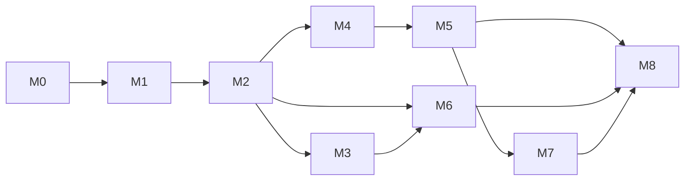

# Implementation Plan — Subodh Exam Modernization

| Field | Value |
|-------|-------|
| Document ID | SUB-PLAN-001 |
| Prerequisite | BRD review & open-question resolution for Must items |

---

## 1. Delivery modules (build order)

| Milestone | Module | Depends on | Key deliverables |
|-----------|--------|------------|------------------|
| M0 | Foundations | — | Solution skeleton, SQL schema, auth, session default, CI |
| M1 | Masters | M0 | Region/District/Centre/Exam/Paper/Users/Institution |
| M2 | Candidate entry | M1 | Subodh CRUD, search, insert-between, lock, count |
| M3 | Roll numbers | M2 | Standard + Aur allocation |
| M4 | Marks entry | M2 | Grid, validation, totals, lock |
| M5 | Result engine | M1, M4 | Generate + special ranks + parity tests |
| M6 | Pre-exam reports | M2, M3 | Attendance, hall ticket, name list, register |
| M7 | Post-exam reports | M5 | Result sheets, certificate, lost-by-two |
| M8 | Utilities & cutover | M5–M7 | Regen, export/backup, migration, UAT, go-live |

---

## 2. Dependencies

**Data dependency:** Encoding conversion spike (OQ-005) should start in M0/M1 — blocks UAT quality.

**Decision dependency:** OQ-001 (roles), OQ-002 (SrNo+3), OQ-004 (passing marks), OQ-006 (lock ownership) before M2/M5 freeze.

---

## 3. Suggested timeline (indicative)

| Phase | Duration (indicative) | Outcome |
|-------|----------------------|---------|
| BRD/FRS review & OQ workshop | 1–2 weeks | Approved scope |
| M0–M1 | 2–3 weeks | Platform + masters |
| M2–M4 | 3–4 weeks | Entry/rolls/marks usable |
| M5 + golden tests | 2–3 weeks | Result parity |
| M6–M7 | 3–4 weeks | PDF reports UAT |
| M8 migration & go-live | 2–3 weeks | Production Subodh |

Actual dates pending team size and OQ closure.

---

## 4. Workstreams

| Stream | Ownership | Notes |
|--------|-----------|-------|
| Domain/API | Backend | Result engine first-class |
| React UI | Frontend | Module pages per inventory |
| Data migration | DBA/BA | 400k+ FormSubodh rows |
| Reports | Full-stack | Layout UAT with ops |
| QA | QA | Traceability to TC-* |

---

## 5. Definition of Done (per milestone)

- FRs for milestone implemented & mapped in RTM.
- Automated tests for critical rules green.
- No undocumented rule changes.
- Demo to business for that module.

---

## 6. Immediate next steps (this week)

1. Review **`01-BRD-Subodh-Exam.md`** with business owner (focus M3–M6 + OQ-001…006).
2. Confirm SrNo+3 and result lock ownership.
3. Approve Unicode migration approach for Hindi names.
4. After BRD approval, freeze FRS and start M0 scaffolding (**do not generate full app until approved**).

---

## 7. Document set location

All Markdown deliverables: `z:\brd doc\subodh\docs\`

| File |
|------|
| `00-Source-Inventory-and-Application-Overview.md` |
| `01-BRD-Subodh-Exam.md` |
| `02-FRS-Subodh-Exam.md` |
| `03-Screen-Inventory.md` |
| `04-Business-Rules-and-Workflows.md` |
| `05-Access-to-SQLServer-Data-Mapping.md` |
| `06-React-Page-Component-Inventory.md` |
| `07-ASPNET-Core-API-Specification.md` |
| `08-Target-Architecture-TDD.md` |
| `09-Requirements-Traceability-Matrix.md` |
| `10-Test-Scenarios-Acceptance-Criteria.md` |
| `11-Implementation-Plan.md` |
